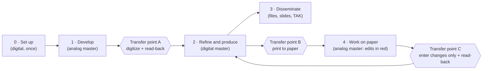

# Analog-first, digital-ready: the planning workflow

Planning starts on paper and acetate most of the time and has to end up digital (slides, TAK,
GIS, C2 systems), and back again when systems go down. This page sets out how work should move
between the two with **the least re-entry** and **no silent loss or corruption of data**. It is
the design basis for Epic 6 (see `docs/EPIC-COA-BUILDER.md`).

The constraints it is designed for:

- Power, network or the accredited system may not be there (DDIL); paper always is.
- Teams mix people who are fast on paper with people who are fast on keyboards.
- Products carry classification markings, and so must every copy in either medium.
- Transcription is where errors enter: a transposed grid digit puts a unit kilometres away, and
  nothing on the screen looks wrong.

## Five rules

**1. Think on any surface; record on a form.**
Acetate, whiteboards and butcher paper are *thinking surfaces*: free-form, fast, for developing
and wargaming COAs. They are never transcribed directly. When a COA is chosen to carry forward,
its content is written onto a *record surface*: a worksheet whose columns are the app's import
fields, in the same order, with the units in the headings. Transcribing a worksheet is mechanical;
transcribing a sketch is interpretation, and interpretation is where data changes meaning.

**2. One master at a time; the master moves only at a transfer point.**
For each product (a COA, a threat model, a forecast) exactly one copy is the master, paper or
digital, and everyone knows which. The master changes medium only at a *transfer point*: a
deliberate step with a check and a sign-off (who, when, which version). Between transfer points,
the other copy is a reference and is marked as such. Two live masters is how versions diverge.

**3. Every item keeps one name in both media.**
Each unit, line and area has a short designation (`1 MRC`, `PL GOLD`, `OBJ IRON`) written on the
paper and stored as its label. Changes on paper cite that name, so they update the item instead of
creating a second one. Names are unique within a COA.

**4. MGRS end to end.**
Grids are what people read off maps and say on the radio, so they are what goes on paper and
into the app: 8-digit (10 m) by default, 10-digit where it matters, always with the grid zone
and square (`18S UJ 2348 0648`). Nobody converts to latitude and longitude by hand; the app
converts. Digits are written in groups of four or five, with the easting and northing in separate
boxes.

**5. Every transfer is read back, and every product carries its marking and version.**
Nothing becomes master until it has been checked against its source (read-back below). Every
printout, slide and file carries the classification marking, the DTG, and a *version
fingerprint*: a short code computed from the content, so a sheet of paper can be matched to the
exact digital version it came from.

## The cycle

| Stage | Master | What happens | In COA Builder | Integrity check | Effort |
|---|---|---|---|---|---|
| **0 · Set up** | Digital | Project, classification marking, area of operations, unit templates for the threat and friendly units you expect, weather critical values. Print blank worksheets. | Projects, marking, Unit templates, Critical values; worksheets (E6-2) | Marking checked once; templates reviewed against references | Once per exercise or operation |
| **1 · Develop** | Analog | COA sketches on acetate over the map; threat templates on paper; the weather officer's forecast on its form. When a COA is chosen to carry forward, fill in its worksheets. | (none: paper) | Worksheets complete: every item named, every grid 8 digits with zone and square | The planning itself; worksheets about 10 min per COA |
| **A · Digitize** | Paper → digital | Enter the worksheets (method by content, below). The app validates on entry. Read back. Sign off; the digital copy becomes master. | CSV / JSON import, MGRS entry (E6-1), photo underlay (E6-5) | All-or-nothing import, every problem by row and column; read-back; counts match | Minutes per COA, not hours |
| **2 · Refine and produce** | Digital | Snap lines, apply unit templates and weapon ranges, place threat plays, rate the weather. Build slides. | Map, Threat models, Weather workspaces; snapping; MGRS grid | Validation on every change; undo; revision numbers | Where the app saves the most time |
| **3 · Disseminate** | Digital | Slides for the brief; KML/KMZ, GeoJSON, TAK, NVG and CSV to other systems. | Export (all formats carry the marking header) | Header with marking, DTG and format on every file; fingerprint (E6-3) | One click per product |
| **B · Print** | Digital → paper | Print what people will work on: slides, overlays at map scale, pre-filled worksheets. Paper now becomes master if the work moves to paper (systems down, field, rehearsal). | Slides today; scaled overlay (E6-4), pre-filled worksheets (E6-2) | Each sheet shows marking, DTG, version fingerprint | Minutes |
| **4 · Work on paper** | Analog | Changes are made in red on the printouts and listed on a change sheet: item name, what changed, new grid, initials and time. | (none: paper) | Every change cites the item's name and the sheet's fingerprint | As needed |
| **C · Enter changes** | Paper → digital | Enter only the change sheet, keyed by item name, against the version it cites. Review the list of differences, then apply. Read back the changed items only. | Change import with preview (E6-3) | Fingerprint must match the digital version, or the conflict is shown; review before saving | Proportional to the changes, not the whole COA |

## Transfer point A: how to digitize, by content

| What you are moving | Best method | Why |
|---|---|---|
| Many units with grids (a SITTEMP, a task organization on the map) | **Unit worksheet → spreadsheet → CSV import** | Typing rows is the fastest entry there is, two people can split the sheet, and the import checks every row before anything is saved. Writing a unit template name (`BMP-2 Coy`) instead of a symbol code fills in the symbol, weapons and details (E6-1). |
| Lines and areas with a few points (phase lines, boundaries, objectives) | **Line worksheet → Lines & areas → Or type the points**, in MGRS (E6-1) | Exact grids, no tracing error. |
| Long or complex shapes (a route, an irregular boundary) | **Photograph the acetate → photo underlay → trace with snapping** (E6-5) | Retyping 40 points is slow and error-prone; tracing a registered photo is fast, and snapping ties the ends to existing points. |
| A handful of edits | **Direct entry on the map** | Below about five items, setting up anything else costs more than it saves. |
| A threat doctrinal template | **Template editor**, units in metres from the reference point | Templates have no grids; the worksheet records x / y in metres. |
| The weather forecast and light data | **The weather form → CSV import** (`docs/WEATHER-IMPORT.md`) | The form's columns are the CSV's columns, with the units in the headings. |

## Read-back

A transfer is complete when the digital copy has been checked against its source:

1. **Counts.** The worksheet footer has the number of units, lines and areas; the app shows the
   same counts. A missing or duplicated row shows up here first.
2. **Grid read-back.** One person reads each grid off the screen (the app shows MGRS); the other
   checks it against the worksheet. Always for HVTs, boundaries, phase lines and objectives;
   otherwise at least every fifth item.
3. **Overlay check.** Print the digital overlay at the paper map's scale onto plain paper or
   transparency (E6-4) and lay it over the original acetate, matching the registration marks. Any
   difference is visible at a glance: this catches the errors read-back misses (a whole line
   offset, an item on the wrong side of a boundary).
4. **Plausibility.** The app flags items outside the area of operations (E6-6): a transposed digit
   usually throws a point kilometres outside it.
5. **Sign-off.** Initials, DTG and the version fingerprint go on the worksheet, and the digital
   copy is now master.

## Errors and the control for each

| Error | Where it enters | Control |
|---|---|---|
| Transposed or dropped grid digit | Writing or typing grids | 8/10-digit boxes on the worksheet; MGRS entry checks the format and the same digit count for both axes; plausibility against the AO; grid read-back |
| Wrong grid zone or 100 km square | Copying a grid without its prefix | The worksheet has the zone and square once in its header, filled before the rows; the app reads the full reference |
| Duplicated item after an update | Re-entering a whole COA instead of the change | Changes keyed by item name (rule 3); change import with preview (E6-3) |
| Two diverging versions | Editing paper and screen at the same time | One master at a time (rule 2); the fingerprint shows which version a sheet came from; a mismatched fingerprint is a conflict, not an overwrite |
| Wrong symbol (affiliation, echelon, type) | Choosing a symbol code by hand | Unit template names on the worksheet; affiliation and echelon as tick boxes |
| Lost or wrong marking | Printing, photographing, exporting | Marking on every sheet, slide and file header, from the project setting; never typed per product |
| Units mixed up (kt / mph, m / ft) | Weather values and ranges | Units in the column headings, one unit per column; the importer converts and refuses mixed units |
| Stale printout used as current | Paper outlives its version | DTG and fingerprint on every sheet; the app shows the current fingerprint |

## Least work: when not to digitize

- **Do not digitize COAs that are discarded.** Only COAs carried forward get worksheets.
- **Digitize at decision points, not continuously.** Transfer at the end of COA development, after
  wargaming, and after the decision; not after every change on the acetate.
- **Enter changes, not documents** (transfer point C).
- **Let templates carry the detail.** A unit template holds the symbol, weapons and reference data
  once; worksheets cite it by name.
- **Keep the free-form work analog.** Brainstorming and wargaming are faster on acetate; the app
  is for precision, production and dissemination.

## Worksheets

Each worksheet is a printed form whose columns are the import format's fields (E6-2), with the
classification marking, project, COA name, page *n of m*, DTG, version fingerprint (when printed
pre-filled) and a sign-off box. One line per item; blank lines are skipped.

- **Units:** name · unit template *or* affiliation ☐F ☐H ☐N ☐U + echelon + type · grid zone and
  square (in the header) · easting · northing · facing · HVT ☐ · remarks.
- **Lines and areas:** name · kind (☐ PL ☐ boundary ☐ axis ☐ route ☐ objective ☐ AA ☐ EA ☐
  area) · side · text above the line · points, one grid per box, in order.
- **Changes:** item name · what (☐ move ☐ add ☐ remove ☐ rename ☐ other) · new value or grid ·
  initials · DTG · version fingerprint of the sheet changed.
- **Weather:** the forecast and light-data forms already match `docs/WEATHER-IMPORT.md`.

## What COA Builder does today, and what is missing

| Rule or step | Today | Missing (Epic 6 story) |
|---|---|---|
| MGRS end to end | ✅ E6-1: MGRS typed anywhere a position is (unit editor, Or type the points, the placement's reference point), in CSV (`mgrs` column) and JSON imports (checked against lat/lng when both are given), shown in the unit editor and the units list, and exported beside the coordinates; the MGRS grid and pointer readout on the map | (done) |
| Worksheets | ✅ E6-2: Export → Worksheets prints units, lines and areas, and change sheets, blank or pre-filled with the version, marking, page numbers and sign-off; CSV templates; the importer reads what is written on paper (codes, X, grids, template names) (`docs/WORKSHEETS.md`) | (done) |
| One master, changes not documents | ✅ E6-3: a version fingerprint on the COA, every slide, worksheet and exported file; **Update from file…** reads a change sheet or an edited export, previews every change by name, refuses a file from another version unless told, and saves one revision (undoable) (`docs/CHANGE-SHEETS.md`) | (done) |
| Overlay check | ✅ E6-4: Export → Overlay at map scale prints the COA at 1:25 000, 1:50 000 or 1:100 000 in its UTM grid with 1 km registration crosses and a 100 mm check bar (`docs/OVERLAYS.md`) | (done) |
| Tracing complex shapes | ✅ E6-5: Map → Photo underlay places a photo or scan by 3 or more typed grids (perspective corrected from 4), shows each point's error in metres, and draws it under the map to trace with snapping (`docs/PHOTO-UNDERLAY.md`) | (done) |
| Plausibility | ✅ E6-6: an area of operations per project (Map section); items outside it flagged ⚠ in the units list, the COA panel, the unit editor and update previews | (done) |
| Provenance | ✅ E6-3: each update is recorded on the COA (when, file, versions before and after, counts, entered by, read back by); export header (marking, project, DTG, application, format, versions) | (done) |
| Markings on every copy | ✅ On slides, worksheets, overlays and every exported file | (done) |

Suggested order: **E6-1** ✅, **E6-3** ✅, **E6-2** ✅, **E6-4** ✅, **E6-6** ✅, **E6-5** ✅: Epic 6 is done.
