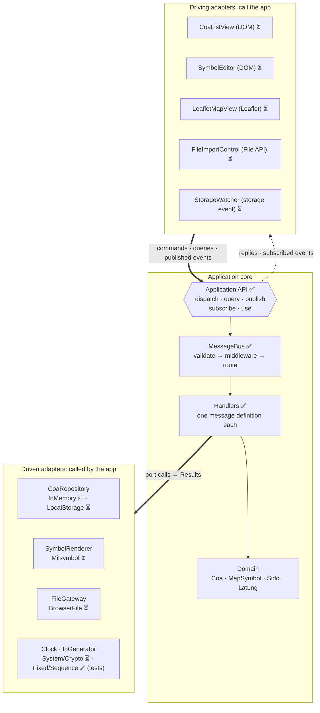
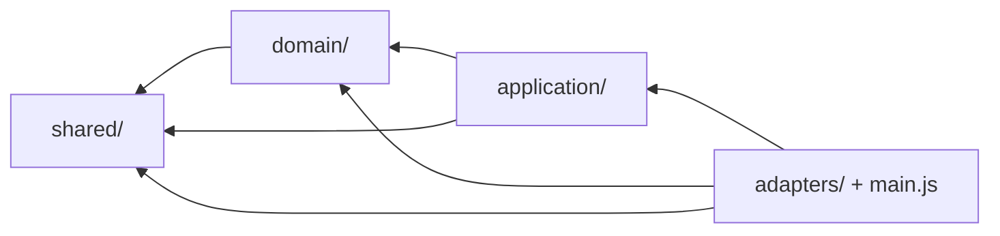
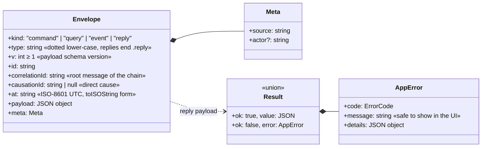
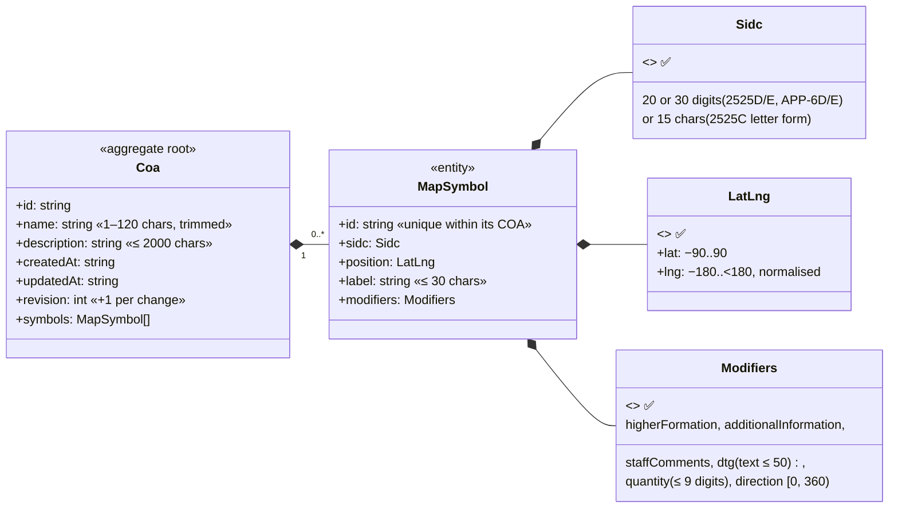
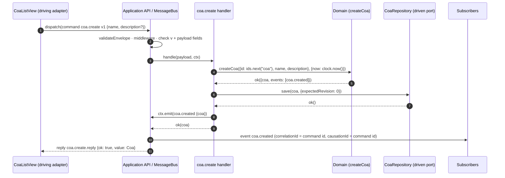
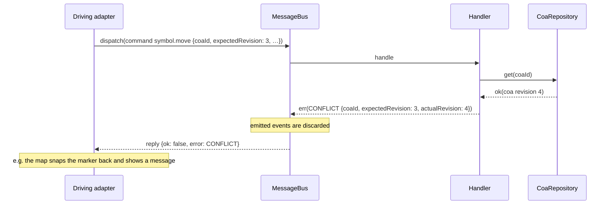
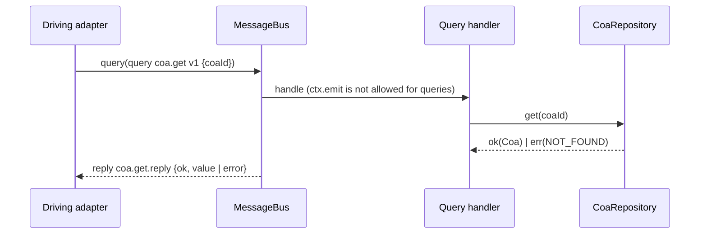
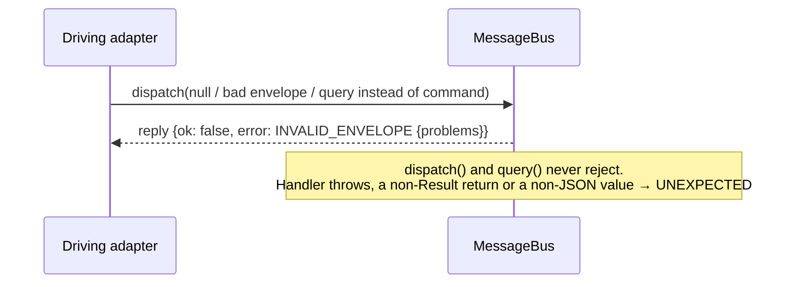
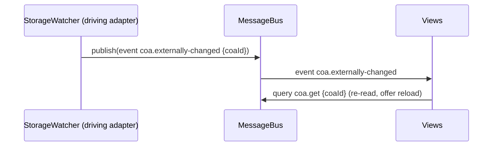

# COA Builder — Architecture reference

The living reference for how the program is put together and **which messages cross each
boundary**. Diagrams are [Mermaid](https://mermaid.js.org/) (GitHub renders them inline).

**Status legend:** ✅ implemented and tested · ⏳ designed, not built yet

> The message catalogue (§6) is checked by `tests/docs.test.js`. Every ✅ command or query row
> must match a message the application registers (same kind and version), and every registered
> message must have a ✅ row. Update this file in the same commit as the code.

---

## 1. The hexagon



`src/main.js` is the **composition root**. It is the only module that creates concrete adapters,
reads browser and vendor globals (`window`, `localStorage`, `L`, `ms`), and passes them into
`createApplication()`.

## 2. Layers and the dependency rule



The rule is enforced by `tests/architecture.test.js` ✅. The core (`shared`, `domain`,
`application`) may only import inward. It may not import adapters, `vendor/` or `tests/`. It may not
use bare, `node:` or URL imports. It may not use host globals (`window`, `document`, `localStorage`,
`fetch`, `Date`, `crypto`, `setTimeout`, `L.`, `ms.`, …). Time and ids come through the Clock and
IdGenerator ports.

## 3. Envelopes and results



| Builder (`src/shared/envelope.js`) | Produces | Ids |
|---|---|---|
| `createEnvelope(input, {id, now})` | root command, query or event | `correlationId = id`, `causationId = null` |
| `deriveEnvelope(parent, input, {id, now})` | a message caused by `parent` (the bus uses this for events) | keeps `correlationId`, `causationId = parent.id` |
| `createReply(request, result, {id, now})` | reply to a command or query | `type = request.type + ".reply"`, `causationId = request.id` |
| `createReplyToInvalid(raw, error, {id, now})` | reply to something that isn't a valid envelope | links to the request when possible, else `causationId = "unknown"` |
| `validateEnvelope(x)` | `Result`. On failure: `INVALID_ENVELOPE { problems: [{field, reason}] }` | — |

All envelopes are deep-frozen copies of plain JSON. A JSON round-trip leaves them unchanged.

## 4. Domain model



The domain is pure functions, `(state, input, {now}) → Result<{coa, events}>`. Ids and time are
passed in. `createCoa` ✅, `updateCoa` ✅, `duplicateCoa` ✅, `addSymbol` ✅, `updateSymbol` ✅, `moveSymbol` ✅,
`removeSymbol` ✅. Commands that change an existing COA share one path (`application/commands/mutate-coa.js`): load → stale-revision check → domain change → save only if something changed → emit.

## 5. Message flows

### 5.1 Command, success: `coa.create` ✅



Events are published **only after** the handler returns `ok`, in emit order, and **before**
`dispatch()` resolves.

### 5.2 Command, failure: nothing is published



### 5.3 Query: `coa.list` / `coa.get` ✅



### 5.4 Anything invalid still gets a reply ✅



### 5.5 Change from outside the app: another browser tab ⏳



## 6. Boundary message catalogue

### 6.1 Application API: the driving port ✅

| Method | Input | Output | Notes |
|---|---|---|---|
| `dispatch(envelope)` | command envelope | `Promise<reply envelope>` | never rejects |
| `query(envelope)` | query envelope | `Promise<reply envelope>` | never rejects; cannot emit events |
| `publish(envelope)` | event envelope from an adapter | `Promise<Result<void>>` | `INVALID_ENVELOPE` if not a valid event |
| `subscribe(pattern, fn)` | `"coa.created"` · `"symbol.*"` · `"*"` | `unsubscribe()` | in-order delivery; a failing subscriber is isolated and reported to `onError` |
| `use(middleware)` | `(envelope, next) => Result` | — | runs in registration order, after envelope validation |

Every command and query reply may also be `INVALID_ENVELOPE`, `UNKNOWN_MESSAGE_TYPE`,
`UNSUPPORTED_VERSION` (`{type, v, supported}`), `VALIDATION_FAILED` for unknown or missing payload
fields, or `UNEXPECTED`. These are not repeated in the tables below.

### 6.2 Commands: driving adapters → core

`VALIDATION_FAILED` details are always `{ problems: [{ field, reason }] }`, with fields named as in the payload.

| Type | Kind | v | Status | Payload | Reply value | Errors | Events published |
|---|---|---|---|---|---|---|---|
| `coa.create` | command | 1 | ✅ | `{ name, description? }` | `Coa` | `VALIDATION_FAILED` (name, description), `STORAGE_*` | `coa.created` |
| `coa.update` | command | 1 | ✅ | `{ coaId, expectedRevision, name?, description? }` | `Coa`. A no-op (no field actually changes) returns the COA unchanged, with no write and no event. | `VALIDATION_FAILED` (coaId, expectedRevision, name, description), `NOT_FOUND`, `CONFLICT` (checked before the no-op test) | `coa.updated` |
| `coa.duplicate` | command | 1 | ✅ | `{ coaId, name? }` | `Coa` (the copy): new id, revision 1, symbols in order with new ids. The default name is `"<name> (copy)"`, shortened to fit 120 characters. | `VALIDATION_FAILED` (coaId, name), `NOT_FOUND`, `STORAGE_*` | `coa.duplicated` |
| `coa.delete` | command | 1 | ✅ | `{ coaId, expectedRevision }` | `{ coaId }` | `VALIDATION_FAILED` (coaId, expectedRevision), `NOT_FOUND`, `CONFLICT`, `STORAGE_*` | `coa.deleted` |
| `symbol.add` | command | 1 | ✅ | `{ coaId, expectedRevision, sidc, position: {lat, lng}, label?, modifiers? }` | `{ coaId, revision, symbol }`. The SIDC is trimmed and upper-cased, lng is wrapped into [-180, 180), label defaults to `""`, modifiers default to `{}`, and empty modifiers are dropped. | `VALIDATION_FAILED` (coaId, expectedRevision, sidc, position.lat/lng, label, modifiers.*), `NOT_FOUND`, `CONFLICT`, `STORAGE_*`. `INVALID_SIDC` (unknown to the renderer) arrives with COA-1.11. | `symbol.added` |
| `symbol.update` | command | 1 | ✅ | `{ coaId, expectedRevision, symbolId, sidc?, label?, modifiers? }`. `modifiers` replaces the whole set; position changes use `symbol.move`. | `{ coaId, revision, symbol }`. A no-op returns the current symbol with no write and no event. | `VALIDATION_FAILED`, `NOT_FOUND {coaId, symbolId?}`, `CONFLICT` (checked first), `STORAGE_*` | `symbol.updated` |
| `symbol.move` | command | 1 | ✅ | `{ coaId, expectedRevision, symbolId, position }` | `{ coaId, revision, symbol }`. If the position is unchanged after wrapping, it's a no-op. | `VALIDATION_FAILED`, `NOT_FOUND {coaId, symbolId?}`, `CONFLICT` (checked first), `STORAGE_*` | `symbol.moved` |
| `symbol.remove` | command | 1 | ✅ | `{ coaId, expectedRevision, symbolId }` | `{ coaId, revision, symbolId }` | `VALIDATION_FAILED`, `NOT_FOUND {coaId, symbolId?}`, `CONFLICT` (checked first), `STORAGE_*` | `symbol.removed` |
| `coa.export` | command | 1 | ⏳ | `{ coaIds: string[] }` | `{ filename }` | `NOT_FOUND`, FileGateway failures | — |
| `coa.import` | command | 1 | ⏳ | `{ document }` (parsed JSON from the file) | `{ coas: Coa[] }` | `IMPORT_INVALID`, `UNSUPPORTED_VERSION` | `coa.imported` (one per COA) |

### 6.3 Queries: driving adapters → core

| Type | Kind | v | Status | Payload | Reply value | Errors |
|---|---|---|---|---|---|---|
| `coa.list` | query | 1 | ✅ | `{}` | `CoaSummary[]`, most recently updated first | `STORAGE_*` |
| `coa.get` | query | 1 | ✅ | `{ coaId }` | `Coa` | `VALIDATION_FAILED` (coaId), `NOT_FOUND` |
| `symbol.preview` | query | 1 | ⏳ | `{ sidc, label?, modifiers?, size? }` | `{ svg, valid, warnings[], anchor: {x, y}, width, height }` | `VALIDATION_FAILED` |

### 6.4 Events: core → subscribers (driving adapters)

All events have `kind: "event"` and `meta.source: "app"`, and carry the command's `meta.actor`
when it had one. `correlationId` and `causationId` point at the command that caused them.

| Type | v | Status | Payload | Typical subscribers |
|---|---|---|---|---|
| `coa.created` | 1 | ✅ | `{ coa }` | CoaListView |
| `coa.updated` | 1 | ✅ | `{ coa, changed: string[] }` | CoaListView |
| `coa.duplicated` | 1 | ✅ | `{ sourceCoaId, coa }` | CoaListView |
| `coa.deleted` | 1 | ✅ | `{ coaId }` | CoaListView, LeafletMapView, SymbolEditor |
| `coa.imported` | 1 | ⏳ | `{ coa }` | CoaListView |
| `coa.externally-changed` | 1 | ⏳ | `{ coaId }`. Published by the StorageWatcher adapter, not by a handler. | all views |
| `symbol.added` | 1 | ✅ | `{ coaId, revision, symbol }` | LeafletMapView, SymbolEditor, CoaListView |
| `symbol.updated` | 1 | ✅ | `{ coaId, revision, symbol, changed: ('sidc' \| 'label' \| 'modifiers')[] }` | LeafletMapView, SymbolEditor |
| `symbol.moved` | 1 | ✅ | `{ coaId, revision, symbolId, from: LatLng, to: LatLng }` | LeafletMapView, SymbolEditor |
| `symbol.removed` | 1 | ✅ | `{ coaId, revision, symbolId }` | LeafletMapView, SymbolEditor, CoaListView |

### 6.5 Driven ports: core → driven adapters

| Port | Method | Returns | Errors | Adapters |
|---|---|---|---|---|
| `Clock` ✅ | `now()` | ISO-8601 UTC string, never goes backwards | — | `FixedClock` ✅ (tests), `SystemClock` ⏳ |
| `IdGenerator` ✅ | `next(prefix?)` | unique non-blank id ≤ 128 chars, starts with prefix | — | `SequenceIdGenerator` ✅ (tests), `CryptoIdGenerator` ⏳ |
| `CoaRepository` ✅ | `list()` | `Promise<Result<CoaSummary[]>>` | `STORAGE_*` | `InMemoryCoaRepository` ✅, `LocalStorageCoaRepository` ⏳ |
| | `get(coaId)` | `Promise<Result<Coa>>` | `NOT_FOUND {coaId}` | |
| | `save(coa, {expectedRevision})` | `Promise<Result<void>>`. `expectedRevision: 0` creates. | `CONFLICT {coaId, expectedRevision, actualRevision}`, `NOT_FOUND`, `STORAGE_*` | |
| | `remove(coaId, {expectedRevision})` | `Promise<Result<void>>` | `NOT_FOUND`, `CONFLICT` | |
| `SymbolRenderer` ⏳ | `render(sidc, {label?, modifiers?, size?})` | `{ svg, valid, warnings[], anchor, width, height }` | — | `MilsymbolRenderer` ⏳, `StubRenderer` ⏳ |
| `FileGateway` ⏳ | `saveJson(filename, data)` | `Promise<Result<void>>` | `UNEXPECTED` | `BrowserFileGateway` ⏳ |

Each driven port has a **contract suite** in `tests/contracts/`. Every adapter for the port, test
doubles included, must pass it.

### 6.6 Error codes

| Code | Meaning | Typical `details` |
|---|---|---|
| `VALIDATION_FAILED` | payload or domain rule broken | `{ problems: [{field, reason}] }` |
| `INVALID_SIDC` | a well-formed SIDC that the SymbolRenderer doesn't recognise. A malformed SIDC is a `VALIDATION_FAILED` problem on `sidc`, so it can be reported together with other problems. | `{ sidc, warnings }` |
| `NOT_FOUND` | no such COA or symbol | `{ coaId }` / `{ coaId, symbolId }` |
| `CONFLICT` | stale `expectedRevision` | `{ coaId, expectedRevision, actualRevision }` |
| `UNKNOWN_MESSAGE_TYPE` | no handler for the type | `{ type }` |
| `INVALID_ENVELOPE` | not a valid envelope, or the wrong kind for the call | `{ problems }` |
| `UNSUPPORTED_VERSION` | payload `v` or stored schema version not supported | `{ type, v, supported }` |
| `STORAGE_UNAVAILABLE` / `STORAGE_QUOTA_EXCEEDED` | storage blocked or full | adapter-specific |
| `IMPORT_INVALID` | an imported file is not a COA document | `{ problems }` |
| `UNEXPECTED` | a bug: a handler, middleware or adapter threw | `{ type, cause }` |

## 7. Data shapes

```jsonc
// Coa (the reply value of coa.create / coa.get; payload.coa of coa.* events)
{ "id": "coa-…", "name": "Envelopment", "description": "", "revision": 1,
  "createdAt": "2026-11-22T20:40:00.000Z", "updatedAt": "2026-11-22T20:40:00.000Z",
  "symbols": [ /* MapSymbol */ ] }

// MapSymbol
{ "id": "sym-…", "sidc": "10031000001211000000", "position": { "lat": 34.05, "lng": -117.6 },
  "label": "A/1-5", "modifiers": { "higherFormation": "1-5 INF" } }

// CoaSummary (coa.list)
{ "id": "coa-…", "name": "Envelopment", "symbolCount": 3, "revision": 4, "updatedAt": "…" }
```

## 8. How the boundaries are tested

Tests send and receive **messages at the boundaries**. They do not call internal functions.

| Boundary | Tested by | What a test does |
|---|---|---|
| Application API (driving port) | `tests/application/*.test.js` using `tests/support/app-harness.js` | Sends command and query envelopes, then asserts on reply envelopes, published events, and later query results. Uses in-memory driven adapters. |
| Message bus mechanics | `tests/application/bus/message-bus.test.js` | Envelopes in and out, with throwaway handlers. |
| Envelope format (shared by every adapter) | `tests/shared/envelope.test.js` | Builds, validates and JSON round-trips envelopes. |
| Driven ports | `tests/contracts/*.contract.js`, run by `tests/adapters/**` and `tests/support/doubles.test.js` | Calls port methods and asserts on the returned Results. |
| UI adapters ⏳ | per view | DOM events in → envelopes dispatched to a fake app; events published → DOM out. |
| Structure | `tests/architecture.test.js`, `tests/skeleton.test.js`, `tests/docs.test.js` | Fitness checks: the dependency rule, the project layout, and this catalogue matching the code. |
