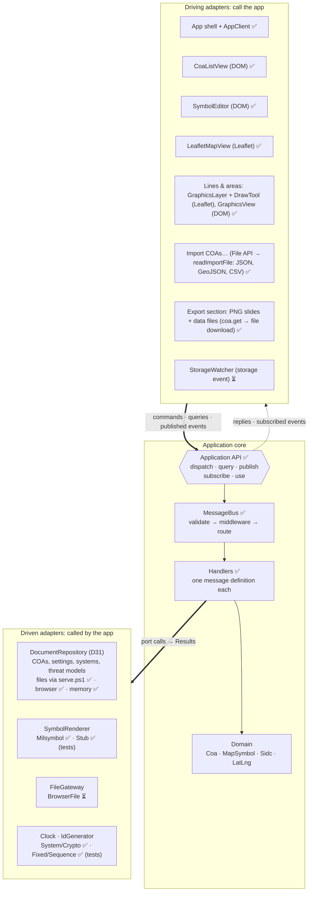
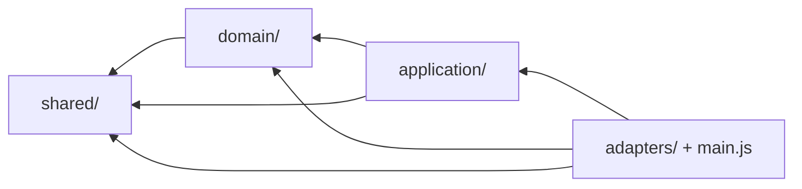
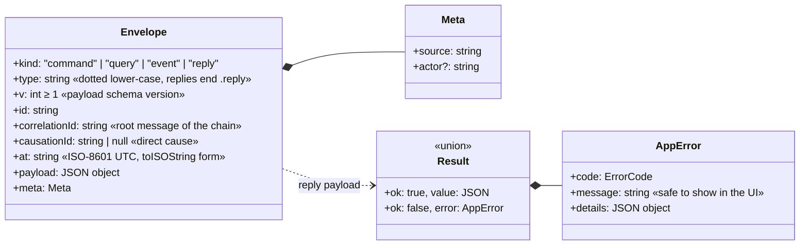
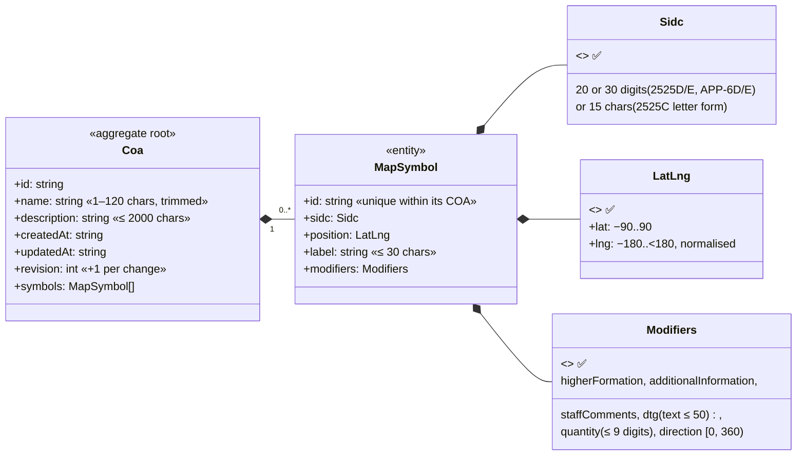
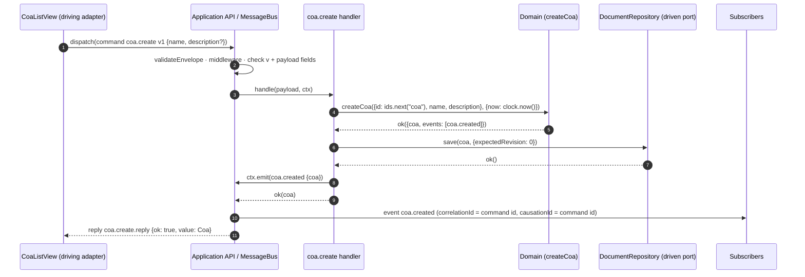
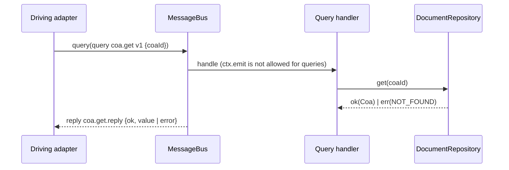
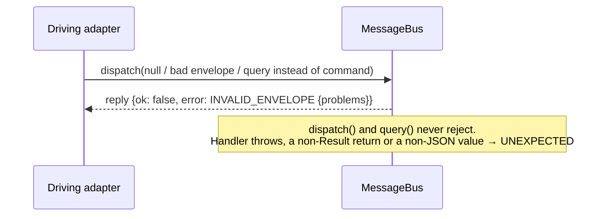
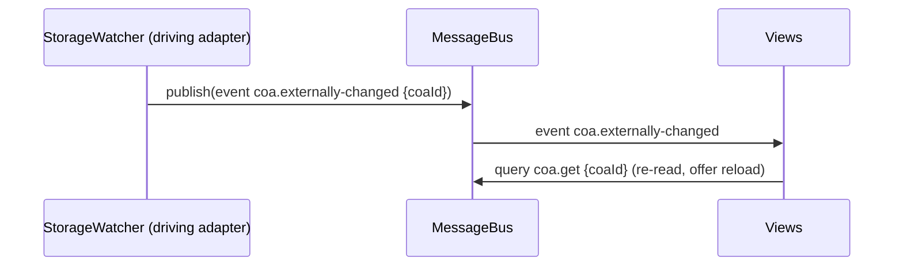

# COA Builder — Architecture reference

The living reference for how the program is put together and **which messages cross each
boundary**. Diagrams are [Mermaid](https://mermaid.js.org/) (GitHub renders them inline).

**Status legend:** ✅ implemented and tested · ⏳ designed, not built yet

> The message catalogue (§6) is checked by `tests/docs.test.js`. Every ✅ command or query row
> must match a message the application registers (same kind and version), and every registered
> message must have a ✅ row. Update this file in the same commit as the code.

---

## 1. The hexagon



`src/main.js` is the **composition root**. It is the only module that creates concrete adapters,
reads browser and vendor globals (`window`, `localStorage`, `L`, `ms`), and passes them into
`createApplication()`.

## 2. Layers and the dependency rule



The rule is enforced by `tests/architecture.test.js` ✅. The core (`shared`, `domain`,
`application`) may only import inward. It may not import adapters, `vendor/` or `tests/`. It may not
use bare, `node:` or URL imports. It may not use host globals (`window`, `document`, `localStorage`,
`fetch`, `Date`, `crypto`, `setTimeout`, `L.`, `ms.`, …). Time and ids come through the Clock and
IdGenerator ports.

## 3. Envelopes and results



| Builder (`src/shared/envelope.js`) | Produces | Ids |
|---|---|---|
| `createEnvelope(input, {id, now})` | root command, query or event | `correlationId = id`, `causationId = null` |
| `deriveEnvelope(parent, input, {id, now})` | a message caused by `parent` (the bus uses this for events) | keeps `correlationId`, `causationId = parent.id` |
| `createReply(request, result, {id, now})` | reply to a command or query | `type = request.type + ".reply"`, `causationId = request.id` |
| `createReplyToInvalid(raw, error, {id, now})` | reply to something that isn't a valid envelope | links to the request when possible, else `causationId = "unknown"` |
| `validateEnvelope(x)` | `Result`. On failure: `INVALID_ENVELOPE { problems: [{field, reason}] }` | — |

All envelopes are deep-frozen copies of plain JSON. A JSON round-trip leaves them unchanged.

## 4. Domain model



The domain is pure functions, `(state, input, {now}) → Result<{coa, events}>`. Ids and time are
passed in. `createCoa` ✅, `updateCoa` ✅, `duplicateCoa` ✅, `addSymbol` ✅, `updateSymbol` ✅, `moveSymbol` ✅,
`removeSymbol` ✅. Commands that change an existing COA share one path (`application/commands/mutate-coa.js`): load → stale-revision check → domain change → save only if something changed → emit.

## 5. Message flows

### 5.1 Command, success: `coa.create` ✅



Events are published **only after** the handler returns `ok`, in emit order, and **before**
`dispatch()` resolves.

### 5.2 Command, failure: nothing is published


### 5.3 Query: `coa.list` / `coa.get` ✅



### 5.4 Anything invalid still gets a reply ✅



### 5.5 Change from outside the app: another browser tab ⏳



## 6. Boundary message catalogue

### 6.0 App client: how views call the app ✅

Views never build envelopes. They use the app client (`src/adapters/ui/app-client.js`):

| Call | Does |
|---|---|
| `send(type, payload, {source?})` | Builds a command envelope and resolves with the reply's `Result`. Commands carrying a `coaId` run **one at a time per COA**. `expectedRevision` is filled in when the command runs, from the newest revision the client has seen; if it has seen none, it asks `coa.get` first. |
| `ask(type, payload, {source?})` | Builds a query envelope and resolves with the `Result`. |
| `subscribe(pattern, fn)` | Passes through to the app. |
| `revisionOf(coaId)` | The newest revision learned from replies and events. A `CONFLICT` never updates it; the user must reload. |
| `close()` | Stops listening to app events. |

**The active COA store** (`src/adapters/ui/active-coa.js`) is the one read model the views share. It loads the selected COA with `coa.get` once per change (on a new selection, or a burst of `coa.*`, `symbol.*` or `graphic.*` events for that COA) and notifies every view: `subscribe(fn(coa | null, { switched, error }))`. Views never fetch the active COA themselves; a test checks that one change causes one read. Exports still read COAs fresh at the moment of export.

**Other windows** (`src/adapters/ui/cross-window-sync.js`): each window announces its own changes on a `BroadcastChannel`; the others reload through the active-COA store, the COA list and the settings. The `storage` event and window focus also reload. This is single-user sync (D20); the core is unchanged.

**Threat models workspace** (Epic 3): `threat-model-store.js` (the selected model and the systems, loaded once per change), `template-canvas.js` (Leaflet `CRS.Simple`: template (x, y) metres is latlng [y, x], so the draw tool and markers work unchanged), `threat-models-view.js` and `template-editor-view.js`. Template edits replace the formation through `threat-model.set-template`. Pure template maths (sectors, coverage, frontage and depth) is in `src/domain/template-geometry.js`, and placement on the map (T-5) is in `src/domain/placement.js`. `placement-preview.js` draws a play on the main map from that same `placePlay`, with a drag anchor and a rotate handle, then sends `threat-coa.place`.

**Undo history** (`src/adapters/ui/undo-history.js`) is UI state: a per-COA stack of earlier content, recorded from the active-COA store and put back with `coa.restore`. The core stores no history.

**One drawing renderer** (M10-4b): the map's graphics layer, the template canvas and the placement preview draw through `src/adapters/ui/views/drawing.js`: a *space* (`MAP_SPACE` lat/lng, `TEMPLATE_SPACE` metres on Leaflet `CRS.Simple`) turns points into Leaflet positions and outlines sectors; `shapeLayer`, `addLabel`, `weaponRanges` and `createIconCache` are shared, so a weapon, a line or a unit looks the same everywhere. Slides use the same domain geometry (`coverageGraphics`, `sectorOutlineGeo`) on a canvas.

**Linked SITTEMPs** (D30, M10-4a): a COA placed from a threat play stays linked to it instead of being a copy that drifts. Each placed unit and drawing carries `link: { key }` (`unit:<id>`, `graphic:<id>`, `move:<unit id>`), and `source` is the georeference (`anchor`, `bearing`, `positions`) plus the `modelRevision` it last followed and the keys the user deleted (`excluded`). The play is the source of truth: `coa.update-from-template` and `coa.re-place` place it again (`placePlay`) and merge (`mergePlacement` in `domain/placement.js`). Rules: moving a linked unit marks it `moved` (fitted to the ground: its position is kept; `symbol.snap-to-template` undoes that); any other edit to a linked unit or drawing makes it the user's own (the link goes); duplicates and copies are never linked. Storage schema v4 adds the links.

**Rich units** (D28, M10-3a): a unit, on a map COA or in a template, carries its own `weapons` (`src/domain/weapon.js`: name, role, ranges in metres, arc), an `hvt` tag, a `facing` and checked `details`. They are values, so they travel with export, import, undo and placement. Ranges are not stored as graphics: `coverageGraphics(unit)` turns a map unit's weapons into range rings and sectors (along its facing, coloured by its side) for the map's graphics layer, the placement preview and slides; `coverageOf(unit)` does the same in template metres. **Unit templates** (M10-3b, D29) are ready-made units in each project's `unit-templates` collection (`src/domain/unit-template.js`); the unit editors start a unit from one and copy weapons from them, and `docs/UNIT-TEMPLATES.md` is their file format. The systems list (`system.*`) has no panel any more: it is kept so old threat models read, and `unit-template.from-systems` turns it into templates. Templates stored before M10-3 named systems by id; they are read with those systems copied in. Storage schema v3 adds the four unit properties.

**Projects** (D27, M10-2): the app runs inside **one project**, given to `createApplication({ projectId })` by the composition root (`main.js` remembers the last one; switching projects reloads the page, as opening another `.aprx` would). `src/application/stores/project-scope.js` gives handlers only that project's documents: the collections `coas`, `settings`, `systems` and `threat-models` become `<collection>--<projectId>`, and the Default project uses the plain names, so data saved before projects is the Default project with nothing moved and `serve.ps1` unchanged (frozen). Projects themselves are in the shared `projects` collection; the project messages also get `allDocuments`. A project's COAs other than the Default project's are kept as plain JSON documents (`serve.ps1` stores them as `data/coas--<projectId>/<id>.json`).

**Storage** (D31): the application has **one** storage port. Handlers reach COAs and the settings through `src/application/stores/coa-store.js`: `coaStore` (collection `coas`: summaries for `coa.list`, and errors re-worded with `{ coaId }` as the message catalogue states) and `settingsStore` (collection `settings`, the one document `settings`; `get()` is `null` before the first save). Two collections keep the places and formats they had before the port was unified (`src/adapters/persistence/stored-collections.js`): `coas` are GeoJSON (`data/<id>.geojson` through `/api/coas`, browser key `<prefix>:coa:<id>`) and `settings` is `data/settings.json` through `/api/settings` (browser key `<prefix>:settings`). The contracts `coa-store.contract.js` and `settings-store.contract.js` run through every adapter, including the real `serve.ps1`.

**Documents** (Epic 3): the `DocumentRepository` port (`src/application/ports/document-repository.js`) stores collections of plain JSON documents `{ id, revision, … }` with the same optimistic concurrency as COAs: in memory, in browser storage (`<prefix>:doc:<collection>:<id>`), or as `data/<collection>/<id>.json` through `serve.ps1`'s `/api/docs/<collection>/<id>`. One contract (`tests/contracts/document-repository.contract.js`) runs against all of them, including the real `serve.ps1`. The first collection is `systems`.

**Storage health** (`src/adapters/ui/storage-health.js`) wraps the app client that every view uses. Any reply with `STORAGE_UNAVAILABLE`, `STORAGE_QUOTA_EXCEEDED` or `UNEXPECTED` raises the storage banner; a background `coa.list` every 5 s, or the next successful save, clears it. Views still get the failed `Result` and handle it as before.

**Content-Security-Policy**: `script-src 'self'` (no inline or injected scripts), `connect-src 'self'`, and images only from the app, `data:`, `blob:` and OpenStreetMap tiles. It is the same in `index.html`, `serve.ps1` and `serve.py` (`tests/csp.test.js`), and the browser specs run under it.

**UI state shared between views** (not domain state, never sent to the app): `selection` (the active COA), `symbolSelection` (the unit being edited; clicking a marker or a list row sets it), `graphicSelection` (the selected line, area or ring), `picker` ("Pick on map": the editor asks, the next map click answers) and `drawer` ("Draw on map", answered by the draw tool). Picking and drawing cancel each other. **Per-viewer preferences** (`adapters/ui/prefs.js`, browser storage, harmless to lose): collapsed panel sections, the COA list level and recently-used history, and the base-map choice.

### 6.1 Application API: the driving port ✅

| Method | Input | Output | Notes |
|---|---|---|---|
| `dispatch(envelope)` | command envelope | `Promise<reply envelope>` | never rejects |
| `query(envelope)` | query envelope | `Promise<reply envelope>` | never rejects; cannot emit events |
| `publish(envelope)` | event envelope from an adapter | `Promise<Result<void>>` | `INVALID_ENVELOPE` if not a valid event |
| `subscribe(pattern, fn)` | `"coa.created"` · `"symbol.*"` · `"*"` | `unsubscribe()` | in-order delivery; a failing subscriber is isolated and reported to `onError` |
| `use(middleware)` | `(envelope, next) => Result` | — | runs in registration order, after envelope validation |

Every command and query reply may also be `INVALID_ENVELOPE`, `UNKNOWN_MESSAGE_TYPE`,
`UNSUPPORTED_VERSION` (`{type, v, supported}`), `VALIDATION_FAILED` for unknown or missing payload
fields, or `UNEXPECTED`. These are not repeated in the tables below.

### 6.2 Commands: driving adapters → core

`VALIDATION_FAILED` details are always `{ problems: [{ field, reason }] }`, with fields named as in the payload.

| Type | Kind | v | Status | Payload | Reply value | Errors | Events published |
|---|---|---|---|---|---|---|---|
| `coa.create` | command | 1 | ✅ | `{ name, description? }` | `Coa` | `VALIDATION_FAILED` (name, description), `STORAGE_*` | `coa.created` |
| `coa.update` | command | 1 | ✅ | `{ coaId, expectedRevision, name?, description?, frame?: Frame | null }`. `frame` sets the COA's own export frame; `null` returns it to the shared frame. | `Coa`. A no-op (no field actually changes) returns the COA unchanged, with no write and no event. | `VALIDATION_FAILED` (coaId, expectedRevision, name, description), `NOT_FOUND`, `CONFLICT` (checked before the no-op test) | `coa.updated` |
| `coa.duplicate` | command | 1 | ✅ | `{ coaId, name? }` | `Coa` (the copy): new id, revision 1, symbols in order with new ids. The default name is `"<name> (copy)"`, shortened to fit 120 characters. | `VALIDATION_FAILED` (coaId, name), `NOT_FOUND`, `STORAGE_*` | `coa.duplicated` |
| `coa.delete` | command | 1 | ✅ | `{ coaId, expectedRevision }` | `{ coaId }` | `VALIDATION_FAILED` (coaId, expectedRevision), `NOT_FOUND`, `CONFLICT`, `STORAGE_*` | `coa.deleted` |
| `symbol.add` | command | 1 | ✅ | `{ coaId, expectedRevision, sidc, position: {lat, lng}, label?, modifiers?, facing? (° true), hvt?, weapons?: [{ name, role, maxRange (m), minRange?, arc? }] (≤ 20), details?: { strength?, equipment?: [{ name, count }], reference?, notes? } }` (unit extras, D28; empty ones are left out) | `{ coaId, revision, symbol }`. The SIDC is trimmed and upper-cased, lng is wrapped into [-180, 180), label defaults to `""`, modifiers default to `{}`, and empty modifiers are dropped. | `VALIDATION_FAILED` (coaId, expectedRevision, sidc, position.lat/lng, label, modifiers.*), `INVALID_SIDC {sidc, warnings}` (well-formed but unknown to the renderer; checked after payload validation and before lookup), `NOT_FOUND`, `CONFLICT`, `STORAGE_*` | `symbol.added` |
| `symbol.update` | command | 1 | ✅ | `{ coaId, expectedRevision, symbolId, sidc?, label?, modifiers?, facing?, hvt?, weapons?, details? }`. An empty extra (`null`, `false`, `[]`, `{}`) removes it. `modifiers` replaces the whole set; position changes use `symbol.move`. | `{ coaId, revision, symbol }`. A no-op returns the current symbol with no write and no event. | `VALIDATION_FAILED`, `INVALID_SIDC` (only when `sidc` is being changed), `NOT_FOUND {coaId, symbolId?}`, `CONFLICT` (checked first), `STORAGE_*` | `symbol.updated` |
| `symbol.move` | command | 1 | ✅ | `{ coaId, expectedRevision, symbolId, position }` | `{ coaId, revision, symbol }`. If the position is unchanged after wrapping, it's a no-op. | `VALIDATION_FAILED`, `NOT_FOUND {coaId, symbolId?}`, `CONFLICT` (checked first), `STORAGE_*` | `symbol.moved` |
| `symbol.remove` | command | 1 | ✅ | `{ coaId, expectedRevision, symbolId }` | `{ coaId, revision, symbolId }` | `VALIDATION_FAILED`, `NOT_FOUND {coaId, symbolId?}`, `CONFLICT` (checked first), `STORAGE_*` | `symbol.removed` |
| `symbol.copy` | command | 1 | ✅ | `{ coaId, expectedRevision, fromCoaId, symbolIds: string[], offset?: {lat, lng} }`. `coaId` is the target (it may equal `fromCoaId`). `offset` is in degrees (`|lat|`, `|lng|` ≤ 180), applied to every copy. | `{ coaId, revision, symbols }`: the copies, with fresh ids, in `symbolIds` order. All or nothing, in one revision of the target. | `VALIDATION_FAILED` (symbolIds, fromCoaId, offset.*; `offset.lat` also if a copy's latitude would leave −90..90), `NOT_FOUND {coaId}` / `{coaId, symbolId}`, `CONFLICT` (target), `STORAGE_*` | `symbol.added` per copy |
| `symbol.remove-many` | command | 1 | ✅ | `{ coaId, expectedRevision, symbolIds: string[] }` | `{ coaId, revision, symbolIds }`. All or nothing, in one revision. | `VALIDATION_FAILED`, `NOT_FOUND {coaId, symbolId}`, `CONFLICT`, `STORAGE_*` | `symbol.removed` per unit |
| `graphic.add` | command | 1 | ✅ | `{ coaId, expectedRevision, kind, side?, color?, label?, points? \| center?, radius? }`. Kinds: lines `phaseLine`, `boundary`, `axisOfAdvance`, `route`, `line` (points ≥ 2); areas `objective`, `assemblyArea`, `engagementArea`, `area` (points ≥ 3); `rangeRing` (center, radius in metres); `sector` (center, radius, bearing ° true, arc °, minRadius?). `side` friendly (default) \| hostile \| neutral \| unknown sets the colour; `color` `#rrggbb` overrides it. | `{ coaId, revision, graphic }` | `VALIDATION_FAILED` (kind, points[i].lat, center, radius, side, color, label), `NOT_FOUND`, `CONFLICT`, `STORAGE_*` | `graphic.added` |
| `graphic.update` | command | 1 | ✅ | `{ coaId, expectedRevision, graphicId, kind?, side?, color? (null: side colour), label?, points? \| center?, radius? }`. The kind can only change within its shape. | `{ coaId, revision, graphic, changed }`; a no-op returns `changed: []`, no event | `VALIDATION_FAILED`, `NOT_FOUND {coaId, graphicId}`, `CONFLICT`, `STORAGE_*` | `graphic.updated` |
| `graphic.remove` | command | 1 | ✅ | `{ coaId, expectedRevision, graphicId }` | `{ coaId, revision, graphicId }` | `VALIDATION_FAILED`, `NOT_FOUND`, `CONFLICT`, `STORAGE_*` | `graphic.removed` |
| `coa.import` | command | 1 | ✅ | `{ document }`: a `coa-builder/import` v1 document (see `docs/IMPORT-FORMAT.md` and `docs/import/coa-import.schema.json`). Other files (GeoJSON, CSV, our storage files) are converted to it by the file-import adapter, which also maps problem paths back to rows/features. | `{ coas: Coa[] }`: always new COAs with fresh ids, never overwriting. | `IMPORT_INVALID { problems: [{ field: "coas[0].units[3].sidc", reason }] }` (all problems at once; nothing imported), `UNSUPPORTED_VERSION { found, supported }`, `STORAGE_*` | `coa.imported` (one per COA) |
| `coa.restore` | command | 1 | ✅ | `{ coaId, expectedRevision, content: { name, description, frame?, symbols, graphics } }`, with ids. Used by undo/redo. `expectedRevision: 0` brings back a deleted COA under the same id. | `Coa` (a new revision; the same COA, no event, when the content already matches) | `VALIDATION_FAILED` (`content.symbols[i].sidc`, `content.graphics[i].points`, duplicate ids, …), `CONFLICT` (changed since, or recreating one that exists), `NOT_FOUND`, `STORAGE_*` | `coa.restored` |
| `system.create` | command | 1 | ✅ | (Superseded by unit templates, D29; kept for data saved before M10-3b, no panel.) `{ name, role: direct \| indirect \| airDefence \| sensor \| other, maxRange (m), minRange? (m), arc? (°, default 360) }` (systems list, D22) | `System` `{ id, revision, name, role, maxRange, minRange?, arc }` | `VALIDATION_FAILED`, `STORAGE_*` | `system.created` |
| `system.update` | command | 1 | ✅ | `{ systemId, expectedRevision, name?, role?, maxRange?, minRange? (null removes), arc? }` | `System` (unchanged, no event, for a no-op) | `VALIDATION_FAILED`, `NOT_FOUND { systemId }`, `CONFLICT { systemId, expectedRevision, actualRevision }`, `STORAGE_*` | `system.updated` |
| `system.delete` | command | 1 | ✅ | `{ systemId, expectedRevision }` | `{ systemId }` | `NOT_FOUND`, `CONFLICT`, `STORAGE_*` | `system.deleted` |
| `threat-model.create` | command | 1 | ✅ | `{ name, description? }` (Epic 3: a threat's doctrinal template, IPB step 3) | `ThreatModel` `{ id, revision, name, description, createdAt, updatedAt, formation: { units: [], graphics: [] }, coas: [] }` | `VALIDATION_FAILED`, `STORAGE_*` | `threat-model.created` |
| `threat-model.update` | command | 1 | ✅ | `{ modelId, expectedRevision, name?, description? }` | `ThreatModel` | `VALIDATION_FAILED`, `NOT_FOUND { modelId }`, `CONFLICT`, `STORAGE_*` | `threat-model.updated` |
| `threat-model.set-template` | command | 1 | ✅ | `{ modelId, expectedRevision, target: "formation" \| <threat COA id>, template: { units: [{ id?, sidc, label?, x, y (m), facing?, weapons?: [Weapon], details?, hvt?, end?: { x, y }, systems?: [systemId] (copied in as weapons, D29) }], graphics: [{ id?, kind, side? (default hostile), label?, color?, points: [{ x, y }] \| center, radius }] } }`. Replaces the whole template; template space is metres, (0, 0) the reference point, +y the direction of attack. | `ThreatModel` (no event for a no-op) | `VALIDATION_FAILED` (`template.units[i].sidc`, `…x`, `…weapons[j].maxRange`, `…systems[j]` (unknown), …), `NOT_FOUND { modelId, coaId }` for an unknown target, `CONFLICT`, `STORAGE_*` | `threat-model.updated` |
| `threat-model.delete` | command | 1 | ✅ | `{ modelId, expectedRevision }` | `{ modelId }` | `NOT_FOUND`, `CONFLICT`, `STORAGE_*` | `threat-model.deleted` |
| `threat-coa.add` | command | 1 | ✅ | `{ modelId, expectedRevision, name, rank?: mostLikely \| mostDangerous \| other (default) }` (IPB step 4). Its play starts as a copy of the formation, with the same unit ids. Only one COA may be most likely, and one most dangerous. | `ThreatModel` | `VALIDATION_FAILED` (name, rank naming the COA that holds it), `NOT_FOUND`, `CONFLICT`, `STORAGE_*` | `threat-model.updated { changed: ["coas"] }` |
| `threat-coa.update` | command | 1 | ✅ | `{ modelId, expectedRevision, coaId, name?, rank?, statement?: { who?, what?, when?, where?, why?, how? } (parts given are replaced; ≤ 1000 characters each), endState? }`. The play is set with `threat-model.set-template`, target = coaId; units may have `end: { x, y }` (D26). | `ThreatModel` (no event for a no-op) | `VALIDATION_FAILED` (`statement.<part>`), `NOT_FOUND { modelId, coaId }`, `CONFLICT`, `STORAGE_*` | `threat-model.updated` |
| `threat-coa.remove` | command | 1 | ✅ | `{ modelId, expectedRevision, coaId }` | `ThreatModel` | `NOT_FOUND`, `CONFLICT`, `STORAGE_*` | `threat-model.updated` |
| `threat-coa.place` | command | 1 | ✅ | `{ modelId, play: "formation" \| <threat COA id>, anchor: { lat, lng }, bearing (° true: the direction of attack), positions: start \| end \| endWithMoves, name? }`. Template point (x, y) goes to the geodesic destination `hypot(x, y)` from the anchor along `bearing + atan2(x, y)` (`domain/placement.js`). Each unit keeps its weapons, HVT tag and details, and its facing becomes a true bearing (bearing + facing); its ranges are drawn from the unit, not stored as graphics. With endWithMoves each move becomes an axis arrow. | `Coa`, a new SITTEMP with `source: { threatModelId, play, anchor, bearing, positions }`, which is kept through changes and undo but not copied by duplicate | `VALIDATION_FAILED` (anchor, bearing, positions, or placed units and graphics that do not fit), `NOT_FOUND { modelId[, coaId] }`, `STORAGE_*` | `coa.placed` |
| `coa.update-from-template` | command | 1 | ✅ | `{ coaId, expectedRevision }` (M10-4a, D30): a COA placed from a threat play takes the play as it is now. Linked units follow its symbols, labels, weapons, HVT tags and details; new units and drawings appear and removed ones go; ids are kept. A unit moved on the map keeps its position; items the user edited (now their own) or deleted (`source.excluded`) are left alone. | `Coa` with `source.modelRevision` updated | `VALIDATION_FAILED` (coaId: not placed), `NOT_FOUND { coaId, modelId[, play] }` (the model or play is gone), `CONFLICT`, `STORAGE_*` | `coa.synced` |
| `coa.re-place` | command | 1 | ✅ | `{ coaId, expectedRevision, anchor?, bearing?, positions? }`: moves or turns a placed COA as one piece (its georeference); also takes the play as it is now. Units moved on the map stay where they were put. | `Coa` | as for `coa.update-from-template`, plus `anchor.*`, `bearing`, `positions` | `coa.synced` |
| `symbol.snap-to-template` | command | 1 | ✅ | `{ coaId, expectedRevision, symbolId }`: a linked unit moved on the map goes back to where the template places it. | `{ coaId, revision, symbolId, from, to }` | `VALIDATION_FAILED` (symbolId not linked), `NOT_FOUND`, `CONFLICT`, `STORAGE_*` | `symbol.moved` |
| `project.create` | command | 1 | ✅ | `{ name }` (≤ 120 characters; D27). The app stays in its open project. | `Project` `{ id ("p" + up to 11 lower-case letters or digits), name, revision, createdAt, updatedAt }` | `VALIDATION_FAILED`, `STORAGE_*` | `project.created` |
| `project.rename` | command | 1 | ✅ | `{ projectId, expectedRevision, name }`. The Default project starts at revision 0 and is stored from its first rename. | `Project` | `VALIDATION_FAILED`, `NOT_FOUND { projectId }`, `CONFLICT { projectId, expectedRevision, actualRevision }`, `STORAGE_*` | `project.renamed` |
| `project.delete` | command | 1 | ✅ | `{ projectId, expectedRevision }`: deletes the project and every COA, setting, system and threat model in it. Not the Default project, and not the open one. | `{}` | `VALIDATION_FAILED` (projectId), `NOT_FOUND`, `CONFLICT`, `STORAGE_*` | `project.deleted` |
| `project.import` | command | 1 | ✅ | `{ document }`: a `coa-builder/project` v1 document as `project.export` writes it. Creates a **new** project with the document's name ("<name> (2)" if that name is taken), settings, COAs, systems and threat models, keeping their ids (so references between them still work). COAs get revision 1; a placed COA's `source` link is not kept. All or nothing. | `Project` | `IMPORT_INVALID { problems: [{ field, reason }] }` (every problem, e.g. `coas[0].symbols[1].sidc`), `UNSUPPORTED_VERSION { found, supported }`, `STORAGE_*` | `project.imported` |
| `unit-template.create` | command | 1 | ✅ | `{ name (≤ 60), sidc, label?, facing?, hvt?, weapons?, details? }` (D29: a ready-made unit; units made from it get a copy) | `UnitTemplate` `{ id, revision, name, sidc, label, …extras }` | `VALIDATION_FAILED` (name, sidc not drawable, `weapons[i].…`, `details.…`), `STORAGE_*` | `unit-template.created` |
| `unit-template.update` | command | 1 | ✅ | `{ templateId, expectedRevision, name?, sidc?, label?, facing?, hvt?, weapons?, details? }` (an empty extra removes it) | `UnitTemplate` (no event for a no-op) | `VALIDATION_FAILED`, `NOT_FOUND { templateId }`, `CONFLICT { templateId, expectedRevision, actualRevision }`, `STORAGE_*` | `unit-template.updated` |
| `unit-template.delete` | command | 1 | ✅ | `{ templateId, expectedRevision }`. Units made from it are not changed. | `{ templateId }` | `NOT_FOUND`, `CONFLICT`, `STORAGE_*` | `unit-template.deleted` |
| `unit-template.import` | command | 1 | ✅ | `{ document }`: a `coa-builder/unit-templates` v1 document (`docs/UNIT-TEMPLATES.md`). Adds every template with new ids; all or nothing. | `{ templates }` | `IMPORT_INVALID { problems }` (e.g. `templates[2].weapons[0].maxRange`), `UNSUPPORTED_VERSION`, `STORAGE_*` | `unit-template.created` (each) |
| `unit-template.from-systems` | command | 1 | ✅ | `{}`: one template per system in the systems list, named after it and carrying it as its one weapon, with a plain hostile land-unit symbol to edit. Names already used are skipped; the systems list is not changed. | `{ templates }` | `STORAGE_*` | `unit-template.created` (each) |
| `settings.update` | command | 1 | ✅ | `{ expectedRevision, frame?: Frame \| null, marking?: { text, color } }`. `Frame = { aspect: "16:9"\|"4:3"\|"5:4", center: {lat, lng}, width }`, where `width` is in degrees of longitude (0 < width ≤ 360). The marking has non-blank text of at most 80 characters, and a colour in `#rrggbb` form. | `Settings` `{ revision, frame, marking }`. An unchanged update is a no-op. | `VALIDATION_FAILED` (frame.*, marking.*), `CONFLICT {coaId: "settings", …}`, `STORAGE_*` | `settings.updated { settings, changed }` |

No `coa.export` command: export is a read and needs no change to the core. Slides include lines, areas and range rings (display item `path`). The Export section reads
COAs with `coa.get` and writes the file itself, for PNG slides (`src/adapters/export/slide-layout.js`,
`paint-slide.js`) and data files (`src/adapters/files/coa-data.js`: JSON, GeoJSON, CSV).

### 6.3 Queries: driving adapters → core

| Type | Kind | v | Status | Payload | Reply value | Errors |
|---|---|---|---|---|---|---|
| `coa.list` | query | 1 | ✅ | `{}` | `CoaSummary[]`, most recently updated first | `STORAGE_*` |
| `coa.get` | query | 1 | ✅ | `{ coaId }` | `Coa` | `VALIDATION_FAILED` (coaId), `NOT_FOUND` |
| `system.list` | query | 1 | ✅ | `{}` | `System[]` by name (natural order); stored documents that are not valid systems are skipped | `STORAGE_*` |
| `threat-model.list` | query | 1 | ✅ | `{}` | summaries `{ id, name, revision, updatedAt, unitCount, coaCount }` by name | `STORAGE_*` |
| `threat-model.get` | query | 1 | ✅ | `{ modelId }` | `ThreatModel` | `NOT_FOUND { modelId }` |
| `project.list` | query | 1 | ✅ | `{}` | `[{ id, name, revision, updatedAt, current }]`: the Default project first (always there), then by name; `current` marks the open one | `STORAGE_*` |
| `project.get` | query | 1 | ✅ | `{ projectId? }` (the open project when left out) | `Project` | `VALIDATION_FAILED`, `NOT_FOUND { projectId }` |
| `project.export` | query | 1 | ✅ | `{}` | The open project as one plain-JSON document: `{ format: "coa-builder/project", version: 1, name, exportedAt, settings: { frame, marking }, coas: Coa[], systems: System[], threatModels: ThreatModel[], unitTemplates: UnitTemplate[] }` | `STORAGE_*` |
| `unit-template.list` | query | 1 | ✅ | `{}` | `UnitTemplate[]` by name (natural order); stored documents that are not valid templates are skipped | `STORAGE_*` |
| `unit-template.export` | query | 1 | ✅ | `{}` | `{ format: "coa-builder/unit-templates", version: 1, templates: [...] }` without ids, ready for `unit-template.import` | `STORAGE_*` |
| `settings.get` | query | 1 | ✅ | `{}` | `Settings`. Before the first save: `{ revision: 0, frame: null, marking: { text: "UNCLASSIFIED", color: "#007a33" } }` | `STORAGE_*` |
| `symbol.preview` | query | 1 | ✅ | `{ sidc, label?, modifiers?, size? }`. `sidc` can be any string; `size` is 10–200, default 40. | `{ svg, valid, warnings[], anchor: {x, y}, width, height }`. A malformed SIDC is still drawn, but `valid` is false and a format warning comes first. | `VALIDATION_FAILED` (sidc not a string, label, modifiers.*, size) |

### 6.4 Events: core → subscribers (driving adapters)

All events have `kind: "event"` and `meta.source: "app"`, and carry the command's `meta.actor`
when it had one. `correlationId` and `causationId` point at the command that caused them.

| Type | v | Status | Payload | Typical subscribers |
|---|---|---|---|---|
| `coa.created` | 1 | ✅ | `{ coa }` | CoaListView |
| `coa.updated` | 1 | ✅ | `{ coa, changed: string[] }` | CoaListView |
| `coa.duplicated` | 1 | ✅ | `{ sourceCoaId, coa }` | CoaListView |
| `coa.deleted` | 1 | ✅ | `{ coaId }` | CoaListView, LeafletMapView, SymbolEditor |
| `coa.imported` | 1 | ✅ | `{ coa }` | CoaListView |
| `coa.restored` | 1 | ✅ | `{ coa }` | active-COA store (all views), CoaListView, undo history |
| `coa.placed` | 1 | ✅ | `{ coa }` | active-COA store, CoaListView |
| `coa.synced` | 1 | ✅ | `{ coa, added, removed }`: a placed COA brought up to date with its play or moved as one piece | active-COA store, CoaListView |
| `system.created` | 1 | ✅ | `{ system }` | SystemsView |
| `system.updated` | 1 | ✅ | `{ system, changed }` | SystemsView |
| `system.deleted` | 1 | ✅ | `{ systemId }` | SystemsView |
| `threat-model.created` | 1 | ✅ | `{ model }` | Threat models workspace |
| `threat-model.updated` | 1 | ✅ | `{ model, changed }` | Threat models workspace |
| `threat-model.deleted` | 1 | ✅ | `{ modelId }` | Threat models workspace |
| `project.created` | 1 | ✅ | `{ project }` | Project section |
| `project.renamed` | 1 | ✅ | `{ project }` | Project section, header |
| `project.deleted` | 1 | ✅ | `{ projectId }` | Project section |
| `project.imported` | 1 | ✅ | `{ project, counts: { coas, systems, threatModels, unitTemplates } }` | Project section |
| `unit-template.created` | 1 | ✅ | `{ template }` | Unit templates section, unit editors |
| `unit-template.updated` | 1 | ✅ | `{ template, changed }` | Unit templates section, unit editors |
| `unit-template.deleted` | 1 | ✅ | `{ templateId }` | Unit templates section, unit editors |
| `coa.externally-changed` | 1 | ⏳ | `{ coaId }`. Published by the StorageWatcher adapter, not by a handler. | all views |
| `symbol.added` | 1 | ✅ | `{ coaId, revision, symbol }` | LeafletMapView, SymbolEditor, CoaListView |
| `symbol.updated` | 1 | ✅ | `{ coaId, revision, symbol, changed: ('sidc' \| 'label' \| 'modifiers' \| 'facing' \| 'hvt' \| 'weapons' \| 'details')[] }` | LeafletMapView, SymbolEditor |
| `symbol.moved` | 1 | ✅ | `{ coaId, revision, symbolId, from: LatLng, to: LatLng }` | LeafletMapView, SymbolEditor |
| `symbol.removed` | 1 | ✅ | `{ coaId, revision, symbolId }` | LeafletMapView, SymbolEditor, CoaListView |
| `graphic.added` | 1 | ✅ | `{ coaId, revision, graphic }` | LeafletMapView, GraphicsView |
| `graphic.updated` | 1 | ✅ | `{ coaId, revision, graphic, changed }` | LeafletMapView, GraphicsView |
| `graphic.removed` | 1 | ✅ | `{ coaId, revision, graphicId }` | LeafletMapView, GraphicsView |

### 6.5 Driven ports: core → driven adapters

| Port | Method | Returns | Errors | Adapters |
|---|---|---|---|---|
| `Clock` ✅ | `now()` | ISO-8601 UTC string, never goes backwards | — | `FixedClock` ✅ (tests), `SystemClock` ✅ |
| `IdGenerator` ✅ | `next(prefix?)` | unique non-blank id ≤ 128 chars, starts with prefix | — | `SequenceIdGenerator` ✅ (tests), `CryptoIdGenerator` ✅ (`randomUUID`, or `getRandomValues` in non-secure contexts) |
| `DocumentRepository` ✅ (D31, the one storage port) | `list(collection)` | `Promise<Result<Doc[]>>` sorted by id. Unreadable stored documents are skipped, not fatal. | `STORAGE_*` | `HttpFileDocumentRepository` ✅ (`serve.ps1`), `LocalStorageDocumentRepository` ✅ (browser), `InMemoryDocumentRepository` ✅. Chosen at start-up by `pickStorage` (files → browser → memory). |
| | `get(collection, id)` | `Promise<Result<Doc>>` | `NOT_FOUND {collection, id}` | |
| | `save(collection, doc, {expectedRevision})` | `Promise<Result<void>>`. `expectedRevision: 0` creates. | `CONFLICT {collection, id, expectedRevision, actualRevision}`, `NOT_FOUND`, `STORAGE_*` | |
| | `remove(collection, id, {expectedRevision})` | `Promise<Result<void>>` | `NOT_FOUND`, `CONFLICT` | |
| `SymbolRenderer` ✅ | `render(sidc, {label?, modifiers?, size?})` | `{ svg, valid, warnings[], anchor, width, height }`, plain JSON. Synchronous, and never throws. | — (invalid is reported with `valid: false`) | `MilsymbolRenderer` ✅ (an unknown symbol set counts as invalid), `StubRenderer` ✅ (tests) |
| `FileGateway` ⏳ | `saveJson(filename, data)` | `Promise<Result<void>>` | `UNEXPECTED` | `BrowserFileGateway` ⏳ |

Each driven port has a **contract suite** in `tests/contracts/`. Every adapter for the port, test
doubles included, must pass it.

### 6.6 Storage boundary: the COA file format and serve.ps1's file API ✅

**File format** (`src/adapters/persistence/geojson-coa.js`). Each COA is one GeoJSON `FeatureCollection`. The same format is used for files, browser storage, and later import/export:

```jsonc
{ "type": "FeatureCollection",
  "coa": { "schemaVersion": 2, "id": "coa-…", "name": "…", "description": "…", "revision": 3,
           "createdAt": "…Z", "updatedAt": "…Z", "frame"?: { … } },
  "features": [
    { "type": "Feature", "id": "sym-…",
      "geometry": { "type": "Point", "coordinates": [-116, 35] },            // [lng, lat]
      "properties": { "sidc": "10031000001211000000", "label": "A/1-5",
                      "higherFormation": "1-5 INF" } },                    // modifiers are flat columns
    { "type": "Feature", "id": "gfx-…",                                       // v2: lines, areas, range rings
      "geometry": { "type": "LineString", "coordinates": [[-118, 34], [-117.8, 34.2]] },
      "properties": { "kind": "phaseLine", "side": "friendly", "label": "PL GOLD" } } ] }
```

**Versions.** 1 = units only; 2 adds features with `properties.kind` (LineString / closed Polygon /
Point + `radius`). Reading migrates step by step (`MIGRATIONS[n]` turns version n into n + 1), so
every storage and import path accepts any supported version and writes the current one. A newer
version gives `UNSUPPORTED_VERSION { found, supported }` and nothing is changed.

Reading trusts nothing. Every field goes through the domain rules, and failures give `IMPORT_INVALID { problems: [{ field: "features[2].properties.sidc", … }] }`. A newer `schemaVersion` gives `UNSUPPORTED_VERSION`.

**File API** (in `serve.ps1`; the contract is `tests/contracts/file-api.contract.js`, run against the real script and its Node fake):

| Request | Responses |
|---|---|
| `GET /api/health` | `200 { storage: "files", dataDir }` |
| `GET /api/coas` | `200 { ids: [...] }`. The server never parses documents for the list; the client reads and validates each one, so a corrupt file can't break it. |
| `GET /api/coas/{id}` | `200` document with `ETag: "<revision>"` · `404` |
| `PUT /api/coas/{id}` + `If-None-Match: *` | `201` created · `409 { expectedRevision: 0, actualRevision }` |
| `PUT /api/coas/{id}` + `If-Match: "<rev>"` | `200` · `409 { expectedRevision, actualRevision }` · `404` |
| `DELETE /api/coas/{id}` + `If-Match: "<rev>"` | `204` · `409` · `404` |
| missing precondition · bad id or body · body > 10 MB · other methods | `428` · `400` · `413` · `405` |

Files are `<dataDir>/<id>.geojson` (default `<app folder>/data`, git-ignored), written to a temp file and then swapped in.

### 6.7 Error codes

| Code | Meaning | Typical `details` |
|---|---|---|
| `VALIDATION_FAILED` | payload or domain rule broken | `{ problems: [{field, reason}] }` |
| `INVALID_SIDC` | a well-formed SIDC that the SymbolRenderer doesn't recognise. A malformed SIDC is a `VALIDATION_FAILED` problem on `sidc`, so it can be reported together with other problems. | `{ sidc, warnings }` |
| `NOT_FOUND` | no such COA or symbol | `{ coaId }` / `{ coaId, symbolId }` |
| `CONFLICT` | stale `expectedRevision` | `{ coaId, expectedRevision, actualRevision }` |
| `UNKNOWN_MESSAGE_TYPE` | no handler for the type | `{ type }` |
| `INVALID_ENVELOPE` | not a valid envelope, or the wrong kind for the call | `{ problems }` |
| `UNSUPPORTED_VERSION` | payload `v` or stored schema version not supported | `{ type, v, supported }` |
| `STORAGE_UNAVAILABLE` / `STORAGE_QUOTA_EXCEEDED` | storage blocked or full | adapter-specific |
| `IMPORT_INVALID` | an imported file is not a COA document | `{ problems }` |
| `UNEXPECTED` | a bug: a handler, middleware or adapter threw | `{ type, cause }` |

## 7. Data shapes

```jsonc
// Coa (the reply value of coa.create / coa.get; payload.coa of coa.* events)
{ "id": "coa-…", "name": "Envelopment", "description": "", "revision": 1,
  "createdAt": "2026-11-22T20:40:00.000Z", "updatedAt": "2026-11-22T20:40:00.000Z",
  "symbols": [ /* MapSymbol */ ] }

// MapSymbol
{ "id": "sym-…", "sidc": "10031000001211000000", "position": { "lat": 34.05, "lng": -117.6 },
  "label": "A/1-5", "modifiers": { "higherFormation": "1-5 INF" } }

// CoaSummary (coa.list)
{ "id": "coa-…", "name": "Envelopment", "symbolCount": 3, "revision": 4, "updatedAt": "…" }
```

## 8. How the boundaries are tested

Tests send and receive **messages at the boundaries**. They do not call internal functions.

| Boundary | Tested by | What a test does |
|---|---|---|
| Application API (driving port) | `tests/application/*.test.js` using `tests/support/app-harness.js` | Sends command and query envelopes, then asserts on reply envelopes, published events, and later query results. Uses in-memory driven adapters. |
| Message bus mechanics | `tests/application/bus/message-bus.test.js` | Envelopes in and out, with throwaway handlers. |
| Envelope format (shared by every adapter) | `tests/shared/envelope.test.js` | Builds, validates and JSON round-trips envelopes. |
| Driven ports | `tests/contracts/*.contract.js`, run by `tests/adapters/**` and `tests/support/doubles.test.js` | Calls port methods and asserts on the returned Results. |
| Storage format | `tests/adapters/persistence/geojson-coa.test.js` (specific reason: the file format is itself a boundary, used by GIS tools, `serve.ps1` and imports) | Converts COA → document → COA and checks invalid documents. |
| Data files ✅ (export and re-import) | `tests/adapters/files/coa-data.test.js` (specific reason: the files are a boundary read by spreadsheets, GIS tools and other systems) | COAs from the real app → JSON/GeoJSON/CSV text → `readImportFile` → `coa.import`: round trips, CSV quoting/BOM/formula defence, problems by row/feature, and the CSV/GeoJSON examples. |
| Import format ✅ | `tests/application/coa-import.test.js` (through `coa.import`); `tests/adapters/files/import-file.test.js` (file text → document); `tests/adapters/rendering/import-examples.test.js` (specific reason: the published examples must render with the real milsymbol) | Documents in → replies and events out. The same file checks that `docs/import/coa-import.schema.json` lists exactly the accepted fields and that every example imports. |
| File API | `tests/contracts/file-api.contract.js` against the Node fake and the real `serve.ps1` | HTTP requests in → statuses, headers and bodies out. |
| App client ✅ | `tests/adapters/ui/app-client.test.js` (Node) | Client calls in → envelopes to a real or recording app; replies and events → Results and remembered revisions. |
| UI adapters ✅ (shell, COA list, map, symbol editor, export, lines & areas: graphics layer, draw tool, panel) | `tests/browser/*.spec.js` in the dependency-free runner `tests/browser/index.html`. Open it on the dev server, or run it headless. | DOM events in → state, envelopes or the app client out; published events → DOM out. Mounted on the real `index.html` markup. |
| `serve.ps1` (dev server; will host the file API in COA-3.2) | `tests/serve/serve-ps1.test.js` starts the real script when PowerShell is available | HTTP requests in → status, headers and bytes out. |
| Structure | `tests/architecture.test.js`, `tests/skeleton.test.js`, `tests/docs.test.js` | Fitness checks: the dependency rule, the project layout, and this catalogue matching the code. |
